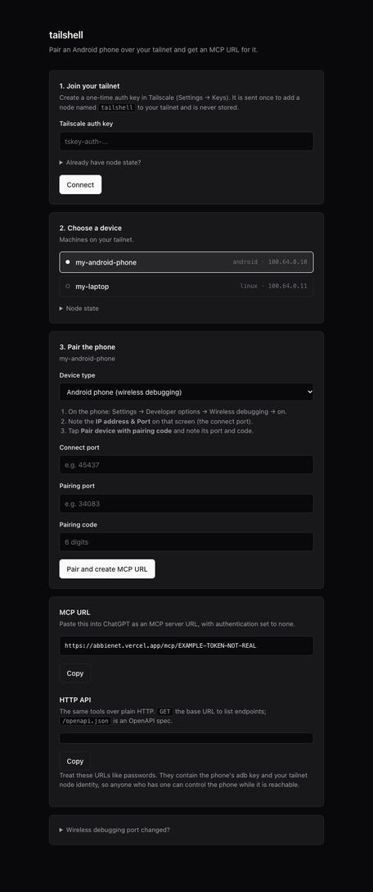
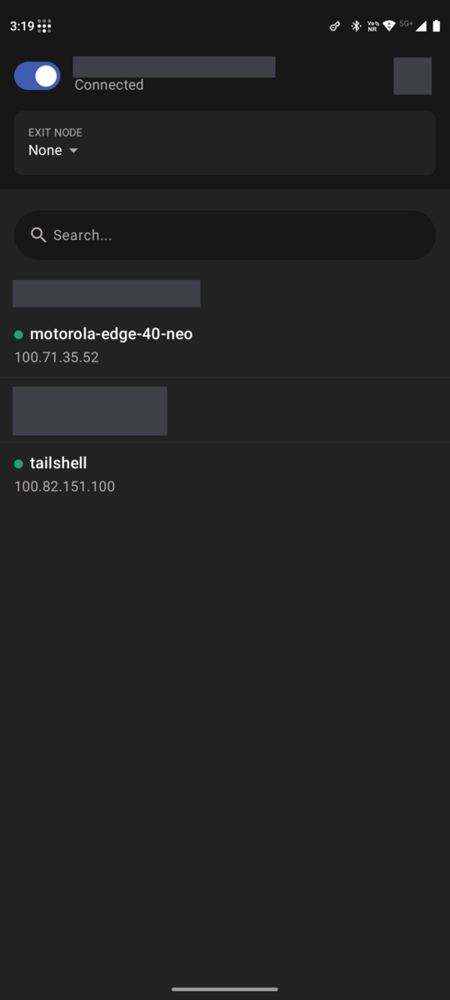
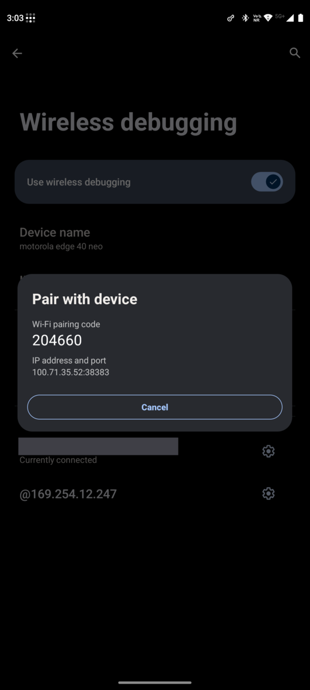

# tailshell

Let an AI agent use your Android phone. tailshell pairs a phone over your private [Tailscale](https://tailscale.com) network and gives you a single URL that exposes it as an **MCP server** (for ChatGPT, Claude, Mistral Le Chat, Claude Code, …) and as a plain **HTTP API** (with an OpenAPI spec).

The agent can look at the screen, tap, swipe, type, press keys, open apps and links, and run shell commands, all over adb wireless debugging.



## How it works

```
AI client ──MCP/HTTP──▶ tailshell (Vercel function) ──Tailscale──▶ your phone (adb wireless debugging)
```

- tailshell runs as a Vercel function. It joins **your** tailnet as a small node called `tailshell` (userspace Tailscale, no VPN setup).
- It runs a real `adb` binary and pairs with your phone through the tailnet.
- **Nothing is stored on the server.** The URL you get is the connection: your Tailscale node identity, the phone's adb key, and the phone's address, compressed and encrypted (AES-GCM) with the deployment's `SEAL_SECRET`. Any request that carries the URL can reach the phone; requests without it can't.

> **The URLs are credentials.** Anyone who has an MCP or HTTP URL can control the phone while it is reachable. Don't paste them into chats, tickets or screenshots. To revoke one, remove the `tailshell` machine in the Tailscale admin console and/or forget the paired device on the phone.

## What you need

- An **Android 11+** phone (wireless debugging was added in Android 11).
- A **Tailscale** account (the free plan is fine) and the Tailscale app on the phone.
- A **Vercel** account to host your own copy (the free plan is fine). Hosting it yourself means only you hold the encryption secret.
- An AI client that supports remote MCP servers (or anything that can make HTTP requests).

## 1. Set up Tailscale

1. Create a Tailscale account at <https://login.tailscale.com> and install the **Tailscale app on your phone** ([Google Play](https://play.google.com/store/apps/details?id=com.tailscale.ipn)). Sign in and turn it on. Your phone now appears in your tailnet with a `100.x.y.z` address.
2. In the Tailscale admin console go to **Settings → Keys → Generate auth key**. A plain one-off key is enough: leave *Reusable* and *Ephemeral* off. If your tailnet has device approval enabled, tick *Pre-approved*. Copy the `tskey-auth-…` key; you'll paste it into tailshell once, and it is never stored.



## 2. Turn on wireless debugging on the phone

1. Enable Developer options: **Settings → About phone**, tap **Build number** seven times (the exact path varies by manufacturer).
2. Open **Settings → System → Developer options → Wireless debugging** and switch it on (Android only lets you turn it on while connected to Wi-Fi).
3. On the Wireless debugging screen, note the **port** in *IP address and port*. That is the **connect port**. The IP shown there can be your Wi-Fi or Tailscale address; only the port matters, because tailshell reaches the phone through its Tailscale address.


## 3. Deploy tailshell to Vercel

```bash
git clone <this repo> tailshell && cd tailshell
npm i -g vercel            # if you don't have the Vercel CLI
vercel link                # create/link a project
openssl rand -hex 32 | vercel env add SEAL_SECRET production
vercel deploy --prod
```

`SEAL_SECRET` is the only setting. It is **not** a login: it is the key that encrypts the URLs tailshell hands out. Keep it safe; **changing it invalidates every URL you've made.** (You can also import the repo in the Vercel dashboard and add `SEAL_SECRET` under *Settings → Environment Variables*.)

Open your deployment (for example `https://tailshell.vercel.app`). If it says the server isn't configured, `SEAL_SECRET` is missing or shorter than 16 characters.

## 4. Pair the phone and get your URLs

1. Paste your **Tailscale auth key** and press **Connect**. tailshell joins your tailnet as `tailshell` and lists your devices. (Already have a node state from an earlier run? Paste it under *Already have node state?* to skip the key.)
2. **Choose your phone** from the list and keep *Android phone* selected.
3. On the phone, open **Wireless debugging → Pair device with pairing code**. A dialog shows a six-digit code and a *pairing* port.
4. Enter the **connect port** (from the main Wireless debugging screen), the **pairing port** and the **pairing code**, then press **Pair and create MCP URL**.



You get two URLs: an **MCP URL** (`…/mcp/<long token>`) and an **HTTP API base URL** (`…/h/<long token>`). The pairing code is single-use and the dialog can be closed afterwards.

## 5. Use it in an AI client

Use the **MCP URL** and set authentication to **none**. The URL itself is the credential. Menu names change often, so if a label differs, check the vendor's page.

### ChatGPT

1. Open ChatGPT in a browser → **Settings → Apps & Connectors** (older builds: *Connectors*). Open **Advanced** and turn on **Developer mode** (on some builds this sits under *Security*).
2. Choose **Create**, name it `tailshell`, paste the MCP URL, and set **Authentication: No authentication**. Confirm that you trust the unverified connector.
3. In a new chat, enable the connector from the tools menu, then ask something like *"Take a look at my phone screen and tell me which apps are open."*

Availability depends on your plan, and custom connectors are web-only on some plans; workspace admins may need to allow them. See [OpenAI's guide](https://developers.openai.com/api/docs/guides/custom-mcp-server).

### Claude (claude.ai and desktop)

**Customize → Connectors → + → Add custom connector**, paste the MCP URL, and leave the OAuth fields empty. On Team/Enterprise plans an owner adds it for the organization. Details: [Anthropic's guide](https://support.claude.com/en/articles/11175166-get-started-with-custom-connectors-using-remote-mcp).

### Mistral Le Chat

Open the side panel → **Intelligence** (called **Context** in newer builds) → **Connectors → + Add Connector → Custom MCP Connector**. Give it a simple name without spaces (`tailshell`), paste the MCP URL, choose no authentication, then enable it in a chat from the tools menu. See [Mistral's help article](https://help.mistral.ai/en/articles/393572-configuring-a-custom-connector).

### Claude Code and other MCP clients

```bash
claude mcp add --transport http tailshell "<MCP URL>"
```

Most clients that support remote (Streamable HTTP) MCP servers just need a name and the URL, for example in a JSON config:

```json
{ "mcpServers": { "tailshell": { "url": "<MCP URL>" } } }
```

Check your client's docs for the exact key names.

### Any HTTP client

The **HTTP API base URL** exposes the same tools as plain endpoints:

```bash
BASE="https://<your-deployment>.vercel.app/h/<token>"

curl "$BASE"                                   # list endpoints
curl "$BASE/openapi.json"                      # OpenAPI 3.1 spec (import it into tools that accept one)
curl "$BASE/info"                              # model, Android version, screen size, foreground app
curl "$BASE/ui"                                # on-screen elements with tap coordinates
curl "$BASE/screenshot" -o screen.png          # PNG of the screen
curl -X POST "$BASE/tap" -H 'content-type: application/json' -d '{"x":540,"y":1200}'
curl -X POST "$BASE/key" -H 'content-type: application/json' -d '{"key":"HOME"}'
curl -X POST "$BASE/open_url" -H 'content-type: application/json' -d '{"url":"https://example.com"}'
```

Read-only endpoints also accept `GET`; anything that changes the phone needs `POST` with a JSON body. Responses are `{"ok": true, "text": "...", "data": {...}}` or `{"ok": false, "error": "..."}`.

## Tools

| Tool | Endpoint | What it does |
|---|---|---|
| `phone_info` | `/info` | Model, Android version, screen size, foreground app |
| `phone_ui` | `/ui` | Text list of on-screen elements with exact tap coordinates (preferred way to read the screen) |
| `phone_screenshot` | `/screenshot` | PNG of the screen |
| `phone_tap` | `/tap` | Tap at x, y |
| `phone_swipe` | `/swipe` | Swipe / scroll |
| `phone_type` | `/type` | Type ASCII text into the focused field |
| `phone_key` | `/key` | HOME, BACK, ENTER, WAKEUP, … |
| `phone_open_app` | `/open_app` | Launch an app by package name |
| `phone_open_url` | `/open_url` | Open an http(s) link |
| `phone_list_apps` | `/list_apps` | Find installed package names |
| `phone_shell` | `/shell` | Run an `adb shell` command (limited shell user) |

Tool descriptions and server instructions are written for agents: they explain the workflow (look, act, verify), the coordinate system, and what to do if the screen is locked.

## When something breaks

| Symptom | Cause | Fix |
|---|---|---|
| "cannot reach the phone" | Phone asleep, Tailscale off on the phone, or wireless debugging off | Wake the phone, check Tailscale and wireless debugging; retry (the first call after idle can be slow) |
| Works, then fails after you toggled wireless debugging | The connect port changed | Use **Wireless debugging port changed?** on the home page with your MCP URL and the new port. No pairing code is needed. Update the URL in your client |
| Connected but "state offline" | A pairing dialog is open on the phone, or the pairing was removed | Close the dialog; if the paired device was forgotten, pair again |
| Invalid URL / 401 | `SEAL_SECRET` was changed, or the URL was truncated | Create a new URL |
| Can't rejoin the tailnet | The `tailshell` machine was deleted, or its key expired (about 180 days by default) | Create a new URL with a fresh auth key |

You can't recover a lost pairing without a new pairing code, and a new URL means updating your AI client.

## Limits and caveats

- **Android only**, 11 or newer. Text entry is ASCII only (no emoji or non-Latin text).
- **The phone screen must be unlocked.** The agent can wake the screen but can't enter a PIN, by design.
- **Screenshots in AI clients:** MCP supports image results, but support varies by client. Community reports suggest ChatGPT may not show or pass the image to the model reliably, so agents are told to prefer `phone_ui`, which returns text. Test your client.
- Vercel limits apply: calls time out at 60 seconds and responses are capped at about 4.5 MB. A cold start (joining the tailnet and starting adb) takes a few seconds.
- There is **no rate limiting** and the service accepts any Tailscale auth key typed into its home page; run your own copy and keep the deployment URL to yourself if that matters to you.
- Whoever holds `SEAL_SECRET` can decrypt the URLs the deployment issued. That's why you should host your own.
- Shell access means an agent can do real damage. Review what your agent is allowed to do and prefer confirm-before-acting modes.

## Project layout

| Path | Purpose |
|---|---|
| `api/index.go` | Vercel function entry point |
| `app/` | Routing: home page, JSON API used by the page, `/mcp/…`, `/h/…` |
| `web/` | The home page (one HTML string compiled into the function) |
| `adbx/` | adb binary download/exec, key handling, pairing, sealed session tokens |
| `tailx/` | Embedded Tailscale (tsnet) nodes from saved state |
| `phone/` | The tool definitions and implementations shared by both transports |
| `mcpx/`, `httpx/` | MCP and HTTP wrappers over `phone/` |

Development:

```bash
go vet ./... && CGO_ENABLED=0 go test ./...
```

(`CGO_ENABLED=0` sidesteps a macOS linker issue with Tailscale's dependencies.) `adbx` downloads Google's `platform-tools` at runtime and does not verify a checksum beyond TLS.

## License

Not yet specified.
