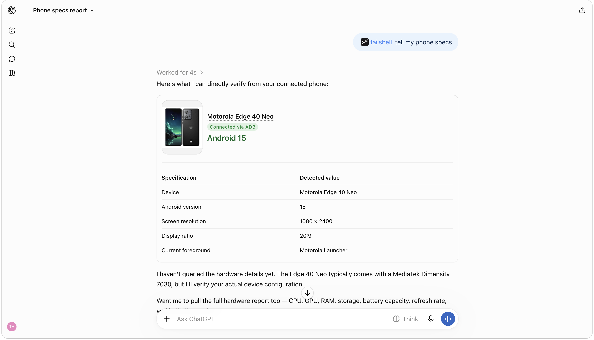
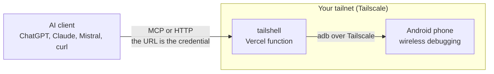
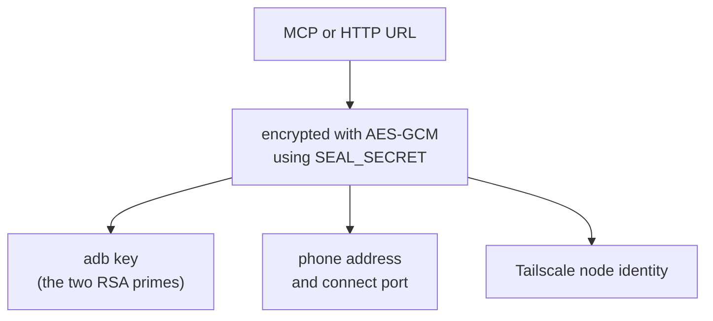
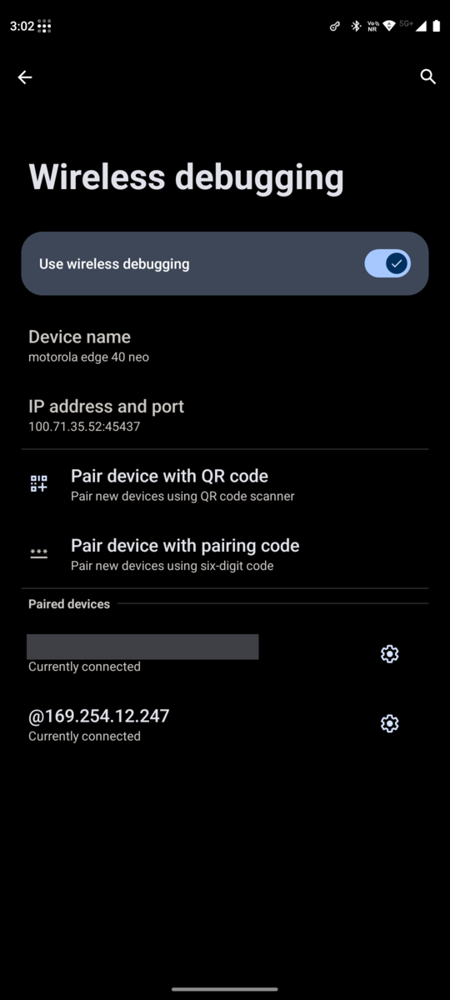
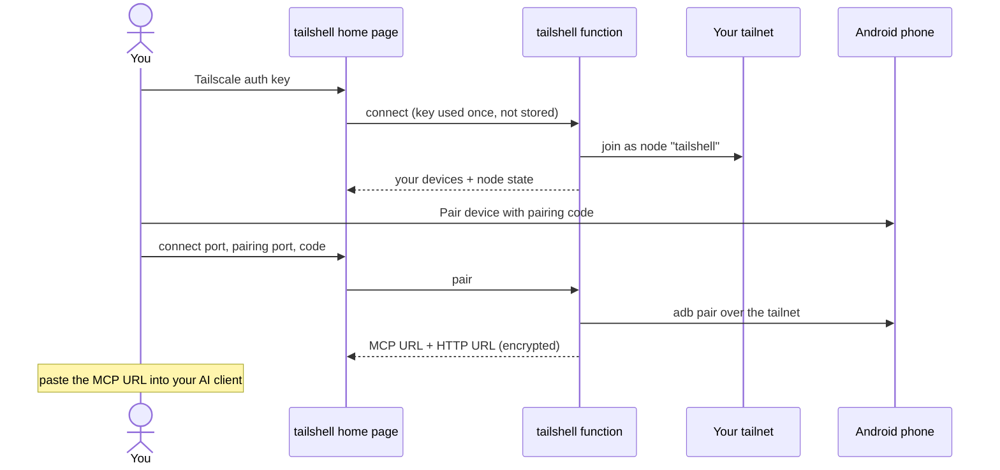
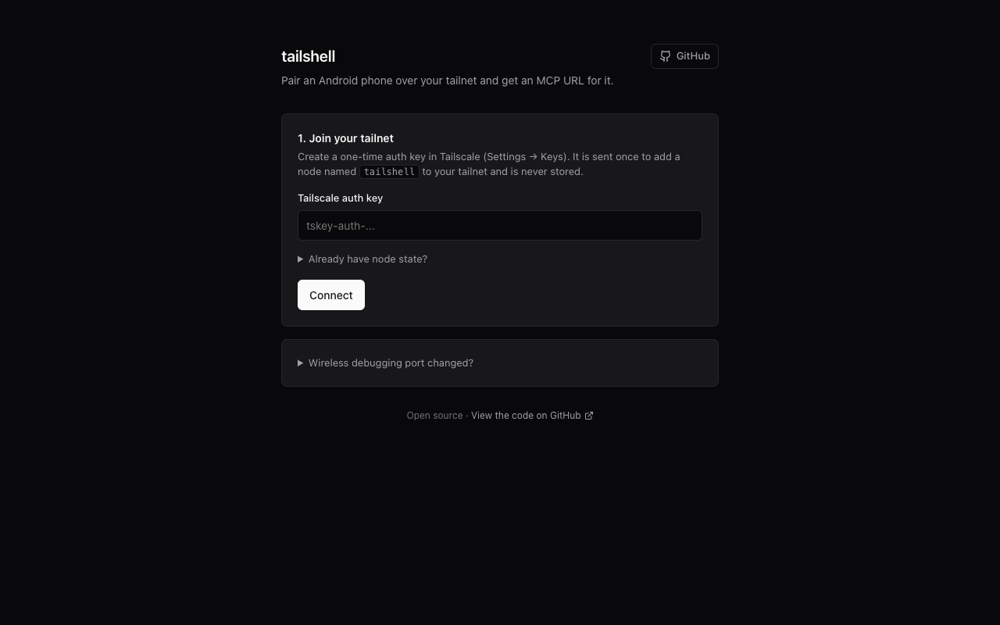
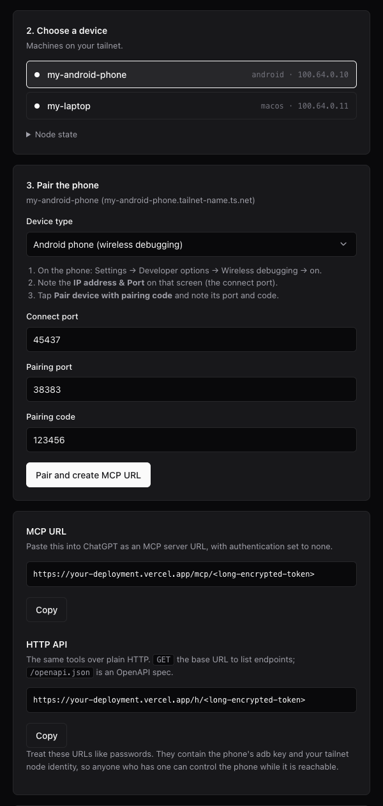
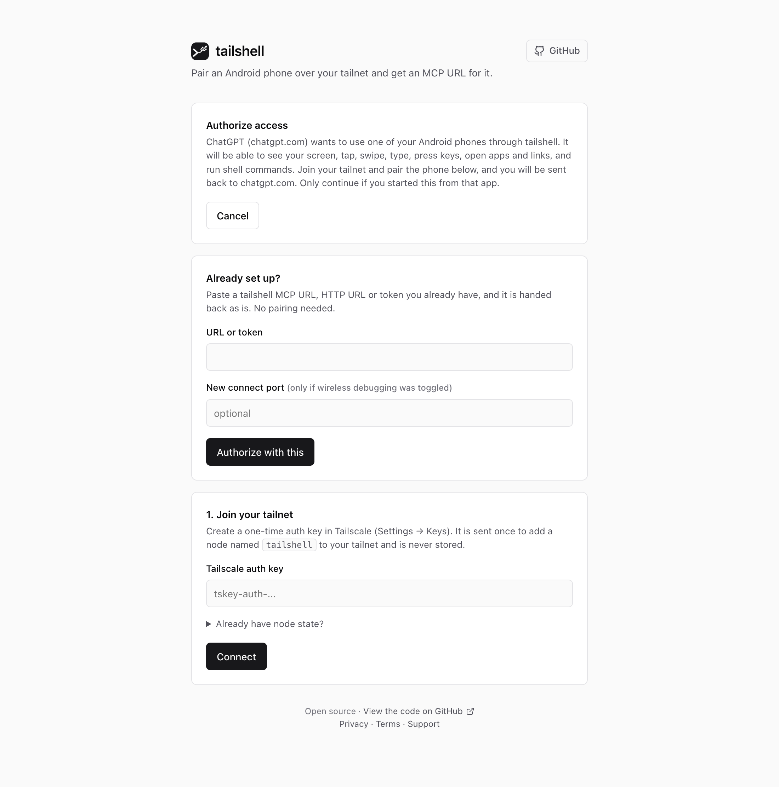

<h1> tailshell</h1>

[](https://vercel.com/new/clone?repository-url=https%3A%2F%2Fgithub.com%2Ftheabbie%2Ftailshell&project-name=tailshell&repository-name=tailshell&env=SEAL_SECRET&envDescription=A%20random%20secret%20of%20at%20least%2016%20characters%20that%20encrypts%20the%20URLs%20tailshell%20issues.%20Generate%20one%20with%3A%20openssl%20rand%20-hex%2032&envLink=https%3A%2F%2Fgithub.com%2Ftheabbie%2Ftailshell%231-deploy-your-own)

Let an AI agent use your Android phone. tailshell pairs a phone over your private [Tailscale](https://tailscale.com) network and gives you a single URL that exposes it as an **MCP server** (for ChatGPT, Claude, Mistral Le Chat, Claude Code, …) and as a plain **HTTP API** with an OpenAPI spec.

The agent can look at the screen, tap, swipe, type, press keys, open apps and links, and run shell commands, all over adb wireless debugging.



## How it works



- tailshell runs as a Vercel function. It joins **your** tailnet as a small node called `tailshell` (userspace Tailscale, no VPN setup).
- It runs a real `adb` binary and pairs with your phone through the tailnet.
- The node connects to your tailnet only while a request is running and disconnects before the function returns. That keeps one reusable identity from being held by an idle, frozen instance (see [parallel calls](#limits-and-caveats)).
- **Nothing is stored on the server.** The URL you get *is* the connection:



Any request that carries the URL can reach the phone; requests without it can't.

> **The URLs are credentials.** Anyone who has an MCP or HTTP URL can control the phone while it is reachable. Don't paste them into chats, tickets or screenshots. To revoke one, remove the `tailshell` machine in the Tailscale admin console and/or forget the paired device on the phone. See [Safeguard your URLs](#safeguard-your-urls).

## What you need

- An **Android 11+** phone (wireless debugging was added in Android 11).
- A **Tailscale** account and the Tailscale app on the phone.
- A **Vercel** account to host your own copy. Hosting it yourself means only you hold the encryption secret.
- An AI client that supports remote MCP servers (or anything that can make HTTP requests).

## 1. Deploy your own

### One click

Press the **Deploy with Vercel** button at the top. Vercel clones this repository into your GitHub, GitLab or Bitbucket account and asks for one environment variable:

| Variable | What to enter |
|---|---|
| `SEAL_SECRET` | A random string of at least 16 characters. Generate one with `openssl rand -hex 32`. |

`SEAL_SECRET` is **not** a login. It is the key that encrypts the URLs tailshell hands out. Keep it safe; **changing it invalidates every URL you've made.** Whoever holds it can decrypt the URLs your deployment issued, which is why you should host your own copy.

### From the command line

```bash
git clone https://github.com/theabbie/tailshell && cd tailshell
npm i -g vercel            # if you don't have the Vercel CLI
vercel link                # create or link a project
openssl rand -hex 32 | vercel env add SEAL_SECRET production
vercel deploy --prod
```

Open your deployment (for example `https://tailshell.vercel.app`). If the page says the server isn't configured, `SEAL_SECRET` is missing or shorter than 16 characters.

### Optional settings

`SEAL_SECRET` is the only required setting. One more is optional:

| Variable | Purpose |
|---|---|
| `OPENAI_APPS_CHALLENGE` | Served as plain text at `/.well-known/openai-apps-challenge`, for the domain-verification step when listing a plugin in OpenAI's directory (see [docs/SUBMISSION.md](docs/SUBMISSION.md)). |

### Pick a region near your phone

Vercel runs a function in one region (the default is `iad1`, Washington D.C.) and doesn't choose one by geography. Every call opens a path to your phone through Tailscale, and each network round trip adds up, so a region close to the phone is much faster. A region isn't one of the Deploy Button's documented parameters, so set it after the first deploy and redeploy.

- In the Vercel dashboard: **Project → Settings → Functions → Function Region** (labels may differ), or
- in `vercel.json`:

```json
{ "regions": ["bom1"] }
```

In one test with the phone in India, a call took about 3.4 s from `iad1` and about 2.0 s from `bom1` (Mumbai). Results depend on where your phone and tailnet are, so try a couple of regions. The plan you're on may limit how many regions you can use.

## 2. Set up Tailscale

1. Create a Tailscale account at <https://login.tailscale.com> and install the **Tailscale app on your phone** ([Google Play](https://play.google.com/store/apps/details?id=com.tailscale.ipn)). Sign in and turn it on. Your phone now appears in your tailnet with a `100.x.y.z` address.
2. In the Tailscale admin console go to **Settings → Keys → Generate auth key**. A plain one-off key is enough: leave *Reusable* and *Ephemeral* off. If your tailnet has device approval enabled, tick *Pre-approved*. Copy the `tskey-auth-…` key. You'll paste it into tailshell once, and it is never stored.


## 3. Turn on wireless debugging on the phone

1. Enable Developer options: **Settings → About phone**, tap **Build number** seven times (the exact path varies by manufacturer).
2. Open **Settings → System → Developer options → Wireless debugging** and switch it on (Android only lets you turn it on while connected to Wi-Fi).
3. On the Wireless debugging screen, note the **port** in *IP address and port*. That is the **connect port**. The IP shown there can be your Wi-Fi or Tailscale address; only the port matters, because tailshell reaches the phone through its Tailscale address.



### Optional: keep it working without Wi-Fi

Wireless debugging only stays on while the phone is on a Wi-Fi network, and Android stops adbd when Wi-Fi drops. If you want tailshell to work away from Wi-Fi, switch the phone to adb over TCP once, while it is still on Wi-Fi.

**The tradeoff:** you still need a Wi-Fi network **once**, because pairing and the switch both go through Wireless debugging, which Android only lets you turn on while connected to Wi-Fi (any network you can use for a few minutes, such as a hotspot from another device). In return, **USB debugging stays on** afterwards instead of Wireless debugging, and the phone then works over mobile data with no Wi-Fi and no cable. After every phone restart you need Wi-Fi once more.


1. Turn on **USB debugging** (Developer options) as well as Wireless debugging. With USB debugging on, adbd keeps running without a cable and without Wi-Fi.
2. In step 4, open **Keep it working without Wi-Fi (optional)** on the pairing form and tick **Switch to adb over TCP after pairing**. After pairing, tailshell runs `adb tcpip 5555` through the connection and gives you a URL that points at port 5555.
3. From then on the URL needs only Tailscale on the phone. Wi-Fi and the Wireless debugging switch can be off.

Already have a URL? Do the same by pasting it and the port `5555` into **Wireless debugging port changed?** on the home page, once the phone has been switched. The default route (wireless debugging only) is unchanged.

What to know:

- Port 5555 resets when the phone restarts. Then you need Wi-Fi once more to repeat the switch.
- USB debugging stays on, and port 5555 is also reachable from other devices on any network the phone joins. They still need the phone's approval of their adb key, and tailshell's key is already approved, but treat the phone accordingly and turn USB debugging off when you don't need this.
- Tested on one phone (Motorola Edge 40 Neo, Android 15). Other makers' Android builds may stop adbd differently.


## 4. Pair the phone and get your URLs





1. Open your deployment, paste your **Tailscale auth key** and press **Connect**. tailshell joins your tailnet as `tailshell` and lists your devices. (Already have a node state from an earlier run? Paste it under *Already have node state?* to skip the key.)
2. **Choose your phone** from the list and keep *Android phone* selected.
3. On the phone, open **Wireless debugging → Pair device with pairing code**. A dialog shows a six-digit code and a *pairing* port.
4. Enter the **connect port** (from the main Wireless debugging screen), the **pairing port** and the **pairing code**, then press **Pair and create MCP URL**.




You get two URLs: an **MCP URL** (`…/mcp/<long token>`) and an **HTTP API base URL** (`…/h/<long token>`). The pairing code is single-use and the dialog can be closed afterwards.

**Save both URLs somewhere safe now, and read [Safeguard your URLs](#safeguard-your-urls) before you paste them anywhere.** They are shown only on this page, and anyone who has them controls the phone.

## Safeguard your URLs

> **Disclaimer.** Each URL tailshell generates is a **secret key, not a link**. It contains your phone's adb key and your Tailscale node identity, encrypted so that only the server can read it, but **whoever holds the URL can control your phone** (see the screen, tap, type, open apps, run shell commands) for as long as the phone is reachable. There is no password, login or second factor in front of it. You are responsible for keeping it private.

- **Treat it like a password.** Store it in a password manager. Don't paste it into chats, tickets, issues, commit messages, docs, screenshots or screen recordings, and never commit it to a repository. Don't open it in shared or untrusted browsers.
- **An OAuth token is the same secret.** What your client stores after you authorize is exactly the session token a URL carries. Removing the connector from the client does not revoke it; use the steps below.
- **Assume your AI client keeps it.** When you add the URL to ChatGPT, Claude, Mistral or any other client, that product stores it, and tool calls to it can be logged or visible to workspace admins. Only add it to accounts and workspaces you trust.
- **Prefer to keep it narrow.** Share it with one client. Make a separate URL for each client or person so you can revoke one without breaking the others.
- **If it may have leaked, revoke it right away:**
  1. Open the Tailscale admin console and **remove the `tailshell` machine** (this cuts the route to your phone for every URL made with that node).
  2. On the phone, open **Wireless debugging → Paired devices** and **forget** the paired entry (this removes the adb key the URL carries).
  3. To invalidate every URL a deployment has ever issued, **change `SEAL_SECRET`** and redeploy.
  4. Then make a fresh URL.
- **Revoke on the way out.** When you stop using tailshell, do steps 1 and 2 above and turn off wireless debugging.
- **Secure the phone itself.** Keep a screen lock on, and turn wireless debugging off when you don't need it. The agent can wake the screen but cannot enter your PIN.

tailshell is provided **as is, without warranty of any kind**. It gives an AI agent real control of a real device. You use it at your own risk, and you are responsible for the accounts, devices and data it can reach and for what your agents do with that access.

## 5. Use it in an AI client

There are two ways to connect an AI client, and both stay available:

| | Secret URL | OAuth |
|---|---|---|
| What you paste into the client | The **MCP URL** from step 4 (it contains the connection) | Just `https://<your-deployment>/mcp` |
| Authentication setting | **None** | **OAuth**, with client ID and secret left empty |
| Where you pair | On the home page, before you add the client | In the window the client opens, when you add it |
| Works with | Any client that accepts a remote MCP URL | Clients that support MCP OAuth with dynamic client registration or client ID metadata documents |

Menu names change often, so if a label differs, check the vendor's page.

### Connecting with OAuth

1. In your client, add a custom MCP server with the URL `https://<your-deployment>/mcp` and choose **OAuth**. Leave the client ID and client secret empty.
2. The client opens a browser window with the tailshell page and a notice saying which app and address you will be sent back to. Only continue if you started this from that app.
   

3. Either **pair the phone** as in step 4 (you'll see *Pair and authorize* instead of the URLs), or, if you already have a tailshell URL or token, paste it under **Already set up?** and press *Authorize with this*. If wireless debugging was toggled since then, enter the new connect port there too.
4. You're sent back to the client, which now holds the connection. Nothing secret appears in the URL you typed.

How it behaves:

- The access token the client receives is the same session token a secret URL carries, so revoking works the same way (see [Safeguard your URLs](#safeguard-your-urls)). It has no expiry and there is no refresh token.
- If the session can never recover (the `tailshell` machine was removed from your tailnet or its key expired), `/mcp` answers `401 invalid_token`, which makes the client ask you to authorize again. Temporary problems, such as the phone being asleep, come back as ordinary tool errors instead.
- If wireless debugging is toggled and the port changes, authorize again and use the paste box with the new port. No pairing code is needed.
- tailshell stores nothing for OAuth either: the client id, the authorization request and the authorization code are encrypted blobs, and codes are valid for five minutes. It supports dynamic client registration, client ID metadata documents (the client's `https` client ID is fetched from public addresses only, without following redirects) and PKCE (`S256`) for public clients, and does not support pre-registered client secrets.

### ChatGPT

1. Open ChatGPT in a browser → **Settings → Apps & Connectors** (older builds: *Connectors*). Open **Advanced** and turn on **Developer mode** (on some builds this sits under *Security*).
2. Choose **Create** and name it `tailshell`. Then either paste the MCP URL and set **Authentication: No authentication**, or paste `https://<your-deployment>/mcp` and choose **OAuth** (see above). Confirm that you trust the unverified connector.
3. In a new chat, enable the connector from the tools menu, then ask something like *"Take a look at my phone screen and tell me which apps are open."*

Availability depends on your plan, and custom connectors are web-only on some plans; workspace admins may need to allow them. See [OpenAI's guide](https://developers.openai.com/api/docs/guides/custom-mcp-server).

**Plugin packaging.** The repo is also a plugin source, but plugins and custom MCP servers connect differently, so pick by where you use ChatGPT:

- **ChatGPT on the web:** add the MCP server directly (above). Choose **OAuth** and **Create as a plugin** to get an installable plugin with the sign-in prompt.
- **ChatGPT desktop app and Codex:** add this repo as a plugin marketplace with `codex plugin marketplace add theabbie/tailshell` (the desktop app reads the same `.agents/plugins/marketplace.json`), then install `tailshell`. The marketplace entry asks to authenticate on install. It points at `https://tailshell.vercel.app/mcp`; change the URL in `plugin/mcp.json` to use your own deployment.
- **Release ZIP:** each [release](https://github.com/theabbie/tailshell/releases) carries `tailshell-plugin-<version>.zip`, built for OpenAI's plugin directory submission (see [docs/SUBMISSION.md](docs/SUBMISSION.md)). Installing it by uploading it as a private plugin does not work: ChatGPT lists the server but never connects to it or shows a sign-in prompt, because a ZIP has no registered connection. Use one of the options above instead.

### Claude (claude.ai and desktop)

**Customize → Connectors → + → Add custom connector**, paste the MCP URL and leave the OAuth fields empty, or paste `https://<your-deployment>/mcp` to sign in with OAuth. On Team and Enterprise plans an owner adds it for the organization. Details: [Anthropic's guide](https://support.claude.com/en/articles/11175166-get-started-with-custom-connectors-using-remote-mcp).

### Mistral Le Chat

Open the side panel → **Intelligence** (called **Context** in newer builds) → **Connectors → + Add Connector → Custom MCP Connector**. Give it a simple name without spaces (`tailshell`), paste the MCP URL, choose no authentication, then enable it in a chat from the tools menu. See [Mistral's help article](https://help.mistral.ai/en/articles/393572-configuring-a-custom-connector).

### Claude Code and other MCP clients

```bash
claude mcp add --transport http tailshell "<MCP URL>"
```

Most clients that support remote (Streamable HTTP) MCP servers just need a name and the URL, for example in a JSON config:

```json
{ "mcpServers": { "tailshell": { "url": "<MCP URL>" } } }
```

Check your client's docs for the exact key names.

### Any HTTP client

The **HTTP API base URL** exposes the same tools as plain endpoints:

```bash
BASE="https://<your-deployment>.vercel.app/h/<token>"

curl "$BASE"                                   # list endpoints
curl "$BASE/openapi.json"                      # OpenAPI 3.1 spec (import it into tools that accept one)
curl "$BASE/info"                              # model, Android version, screen size, foreground app
curl "$BASE/ui"                                # on-screen elements with tap coordinates
curl "$BASE/screenshot" -o screen.png          # PNG of the screen
curl -X POST "$BASE/tap" -H 'content-type: application/json' -d '{"x":540,"y":1200}'
curl -X POST "$BASE/key" -H 'content-type: application/json' -d '{"key":"HOME"}'
curl -X POST "$BASE/open_url" -H 'content-type: application/json' -d '{"url":"https://example.com"}'
```

Read-only endpoints also accept `GET`; anything that changes the phone needs `POST` with a JSON body. Responses are `{"ok": true, "text": "...", "data": {...}}` or `{"ok": false, "error": "..."}`.

## Run it locally

The service is a plain `net/http` handler, so you can run it on your own machine instead of Vercel. You need Go (see `go.mod` for the version) and `SEAL_SECRET`:

```bash
export SEAL_SECRET=$(openssl rand -hex 32)
CGO_ENABLED=0 go run ./cmd/local          # listens on http://127.0.0.1:8787
```

Set `ADDR` to change the listen address (for example `ADDR=0.0.0.0:8080`). Open the printed address and follow section 4. The pairing URLs it produces point at that local address.

- **adb:** tailshell uses an `adb` already on your `PATH`, and otherwise downloads Google's platform-tools for Linux or macOS. Use a recent adb (wireless pairing needs version 30 or newer).
- **Reachability:** hosted AI clients such as ChatGPT can only call a public HTTPS address, so a local instance suits local clients (Claude Code, `curl`, scripts). To use it from a hosted client you would need to expose it through your own tunnel or reverse proxy.
- **Same secret, same URLs:** URLs are encrypted with `SEAL_SECRET`, so a URL made by one instance works on any instance that has the same secret.

## Tools

| Tool | Endpoint | What it does |
|---|---|---|
| `phone_info` | `/info` | Model, Android version, screen size, foreground app |
| `phone_ui` | `/ui` | Text list of on-screen elements with exact tap coordinates (the preferred way to read the screen) |
| `phone_screenshot` | `/screenshot` | PNG of the screen |
| `phone_tap` | `/tap` | Tap at x, y |
| `phone_swipe` | `/swipe` | Swipe or scroll |
| `phone_type` | `/type` | Type ASCII text into the focused field |
| `phone_key` | `/key` | HOME, BACK, ENTER, WAKEUP, … |
| `phone_open_app` | `/open_app` | Launch an app by package name |
| `phone_open_url` | `/open_url` | Open an http(s) link |
| `phone_list_apps` | `/list_apps` | Find installed package names |
| `phone_shell` | `/shell` | Run an `adb shell` command (limited shell user) |
| `phone_socket` | `/socket` | Send one request to a socket or port on the phone itself and return the reply, e.g. Chrome's DevTools |

### Talking to a local socket (Chrome DevTools)

`adb shell` runs as a restricted user that Android's SELinux policy keeps away from other apps' sockets, but the adb daemon itself may open them (that is how `adb forward` works). `phone_socket` asks the daemon to open `localabstract:NAME`, `localfilesystem:/PATH` or `tcp:PORT` on the phone, sends one request, returns the reply and closes. No forward or port is created, and nothing stays connected.

Pick one of three modes per call: `http_path` (one HTTP request), `websocket_path` with `messages` (text frames, returns the frames received) or `send` (raw text).

Example, Chrome on Android, over the HTTP API (`POST /socket` with a JSON body):

```json
{"target": "localabstract:chrome_devtools_remote", "http_path": "/json"}
```

lists the open tabs with their ids, and

```json
{"target": "localabstract:chrome_devtools_remote",
 "websocket_path": "/devtools/page/<id>",
 "messages": ["{\"id\":1,\"method\":\"Runtime.evaluate\",\"params\":{\"expression\":\"document.title\"}}"]}
```

runs JavaScript in that tab and returns the result. The same arguments work through the MCP tool.

Things to know:

- This reads and controls the browser itself: page contents, cookies and logged-in sessions. Treat it like the shell tool, and use it only on tabs the task needs.
- Chrome must be running and USB debugging must be on, which is the same condition as for `adb forward` (tested on one phone, Chrome 157, Android 15).
- Chrome on Android may refuse to create a new tab (`/json/new` answers `Could not create new page`); working with existing tabs is reliable.
- Each call is independent: it connects, sends, reads, closes. Debugger state such as breakpoints does not persist between calls.

Tool descriptions and server instructions are written for agents: they explain the workflow (look, act, verify), the coordinate system, and what to do if the screen is locked.

## When something breaks

| Symptom | Cause | Fix |
|---|---|---|
| "cannot reach the phone" | Phone asleep, Tailscale off on the phone, wireless debugging off (or, on the TCP route, USB debugging off or the phone restarted) | Wake the phone, check Tailscale and wireless debugging, then retry (the first call after idle can be slow) |
| Works, then fails after you toggled wireless debugging | The connect port changed | Use **Wireless debugging port changed?** on the home page with your MCP URL and the new port. No pairing code is needed. Update the URL in your client |
| Connected but "state offline" | A pairing dialog is open on the phone, or the pairing was removed | Close the dialog; if the paired device was forgotten, pair again |
| The client keeps asking you to authorize, or errors with `invalid_token` | The `tailshell` machine was removed or its key expired, or `SEAL_SECRET` changed | Authorize again; with an old URL or token the paste box on the page is enough if the machine still exists, otherwise pair again with a fresh auth key |
| Invalid URL / 401 | `SEAL_SECRET` was changed, or the URL was truncated | Create a new URL |
| Can't rejoin the tailnet | The `tailshell` machine was deleted, or its key expired (about 180 days by default) | Create a new URL with a fresh auth key |
| Slow or failed calls, and a **Duplicate node key** warning on the `tailshell` machine in Tailscale | Several requests ran at the same moment on different function instances, and each tried to use the node's single key | Run tool calls one at a time and retry. The warning normally clears once the overlap stops; if calls keep failing with "node key is in use elsewhere", remove the `tailshell` machine in Tailscale and create a new URL |

You can't recover a lost pairing without a new pairing code, and a new URL means updating your AI client.

## Limits and caveats

- **Android only**, 11 or newer. Text entry is ASCII only (no emoji or non-Latin text).
- **The phone screen must be unlocked.** The agent can wake the screen but can't enter a PIN, by design.
- **Screenshots in AI clients:** MCP supports image results, but support varies by client. Community reports suggest ChatGPT may not show or pass the image to the model reliably, so agents are told to prefer `phone_ui`, which returns text. Test your client.
- **Parallel calls can conflict.** tailshell reuses a single Tailscale identity and reconnects for each request, which is why each call takes a few seconds. Calls that overlap in time may be handled by different function instances, and each of them then tries to use the same node key. Tailscale allows only one live connection per key, so overlapping calls can be slow or fail, and the Tailscale admin console may briefly show a "Duplicate node key" warning. Use clients or settings that call tools one at a time, and retry on failure. Several requests handled by the same instance share one connection and are fine.
- **Vercel limits apply:** calls time out at 60 seconds and responses are capped at about 4.5 MB. A cold start (joining the tailnet and starting adb) takes a few seconds. Every call also reconnects to Tailscale, so expect roughly 2 seconds with a nearby region and 3 to 4 seconds from the other side of the world.
- **No rate limiting**, and the service accepts any Tailscale auth key typed into its home page. Run your own copy, and keep the deployment URL to yourself if that matters to you.
- **Shell access means an agent can do real damage.** Review what your agent is allowed to do and prefer confirm-before-acting modes.
- adb comes from Google's `platform-tools` download, which is not checksum-verified beyond TLS.

## Project layout

| Path | Purpose |
|---|---|
| `api/index.go` | Vercel function entry point |
| `cmd/local/` | Local server entry point |
| `app/` | Routing: home page, JSON API used by the page, `/mcp/…`, `/h/…` |
| `web/` | The home page (one HTML string compiled into the function) |
| `adbx/` | adb binary discovery and execution, key handling, pairing, sealed session tokens |
| `tailx/` | Embedded Tailscale (tsnet) nodes from saved state |
| `phone/` | The tool definitions and implementations shared by both transports |
| `mcpx/`, `httpx/` | MCP and HTTP wrappers over `phone/` |
| `plugin/` | Plugin package for directory listing: manifest, MCP declaration, logo, onboarding skill |
| `.agents/plugins/` | Marketplace file that lets Codex and the ChatGPT desktop app install `plugin/` from this repo |
| `docs/` | Screenshots, and the plugin submission checklist |
| `oauthx/` | Stateless OAuth: discovery documents, client registration, authorization codes, token endpoint |

Development:

```bash
go vet ./... && CGO_ENABLED=0 go test ./...
```

`CGO_ENABLED=0` avoids a linker issue we hit on macOS with Tailscale's dependencies.

## Credits

tailshell stands on other people's work:

| What | Used for | License / terms |
|---|---|---|
| [Tailscale](https://tailscale.com) and its [`tsnet`](https://pkg.go.dev/tailscale.com/tsnet) library | The embedded userspace node that reaches your phone over your tailnet. It is tailshell's only direct Go dependency; its transitive dependencies (about 600 modules, listed in `go.mod`/`go.sum`) each carry their own licenses | BSD 3-Clause |
| [Go](https://go.dev) | Language, standard library, runtime | BSD 3-Clause |
| [Android platform-tools (`adb`)](https://developer.android.com/tools/adb) by Google | Pairing and controlling the phone. Downloaded from `dl.google.com` at runtime and never bundled in this repository | See Google's terms for the SDK platform-tools |
| [Vercel](https://vercel.com) | Hosting, the Deploy Button and its button image (loaded from vercel.com) | Vercel's terms |
| [Lucide](https://lucide.dev) | The `github`, `external-link` and `chevron-down` icons on the home page, and the geometry of the branching tail in the logo, adapted from its `usb` icon | ISC; portions derived from [Feather](https://feathericons.com) (MIT) |
| [Model Context Protocol](https://modelcontextprotocol.io) | The protocol the MCP endpoint implements | Specification |
| [OpenAPI Specification](https://www.openapis.org) | The format of the generated `/openapi.json` | Specification |
| [Mermaid](https://mermaid.js.org) | Diagrams in this README (rendered by GitHub; syntax checked with `mermaid-cli`) | MIT |
| [Playwright](https://playwright.dev) (headless Chromium) and [ImageMagick](https://imagemagick.org) | Capturing and redacting the screenshots in `docs/screenshots/` | Apache-2.0 / ImageMagick License |

The screenshots show the Android Settings app and the Tailscale app. Tailscale, Android, Google, GitHub, Vercel, USB (a mark of the USB Implementers Forum, which the logo alludes to without copying), ChatGPT, OpenAI, Claude, Anthropic and Mistral are trademarks of their respective owners. tailshell is an independent project and is not affiliated with or endorsed by any of them.

## License

MIT. See [LICENSE](LICENSE).
